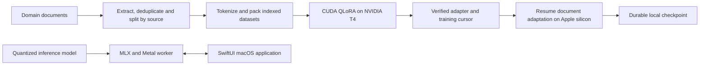

# Vedaris Advisor LLM Training & Apple Metal Inference

    
    
    
   
  

Vedaris Advisor is a native macOS language-model application for AWS architecture and systems engineering. It runs a quantized 4-billion-parameter model on an M4 Mac mini using MLX and Metal. Its training workflow prepares domain documents for parameter-efficient adaptation and lets an interrupted run continue on a different GPU backend.

The central engineering result was a working handoff from an NVIDIA T4 to Apple silicon. The CUDA run saved LoRA weights, a deterministic dataset cursor and the number of tokens processed. The Mac imported the adapter, resumed at example **3,916**, and saved a new checkpoint at example **4,146**.

## Measured milestones

| Milestone | Recorded result |
| --- | ---: |
| Model size | 4 billion parameters |
| Context budget configured in the macOS app | 8,192 tokens |
| Packed document training set | 164,572 examples / 57,925,457 tokens |
| Held-out document validation set | 3,610 examples / 1,449,626 tokens |
| CUDA checkpoint before migration | 979 updates / 3,916 examples |
| Document tokens recorded at CUDA checkpoint | 1,377,147 |
| Document tokens recorded at Apple silicon checkpoint | 1,454,362 |
| Document examples advanced after migration | 230 |

Corpus totals describe the prepared dataset. Checkpoint totals describe the portion processed by each recorded run. The shipped local inference configuration and the adaptation checkpoints were tracked separately.

## Architecture

### Native macOS inference

The SwiftUI app launches a local inference worker as a child process. The app sends generation requests through standard input and decodes newline-delimited JSON events from standard output. The worker reports readiness and model metadata, then streams generation events back to the conversation view. The interface can display the answer as it arrives while the model runs in the separate process. Standard error has its own pipe so diagnostics stay separate from the application protocol.

The worker loads a 4-bit model from local storage and runs under MLX on the Apple GPU. The application uses an 8,192-token context budget and stores conversations locally. It does not require a hosted inference service to generate a response. The native app also includes conversation management, attachment handling, and rendering for formatted responses and code. The installation check recorded matching conversation-store hashes before and after the model integration.

For the compute framework and upstream model provenance, see [Apple MLX](https://github.com/ml-explore/mlx) and [Model attribution](MODEL-ATTRIBUTION.md).

### Building the domain corpus

The corpus brings together AWS whitepapers, service manuals, Well-Architected guidance, prescriptive guides, course materials, research papers, and systems documentation. The systems portion spans Linux, Kubernetes, Terraform and OpenTofu, PostgreSQL, NGINX, observability, security, networking, and programming language documentation.

The preparation step normalizes extracted text and hashes it to identify duplicates. It excluded **1,807 duplicate pages** and **397 short pages**. Document validation is assigned by source, keeping chunks from the same source together. Course materials are assigned to the training split. Internal lineage records preserve the source document, page, and token offset for each example.

Both trainers read the packed data through memory-mapped arrays. One file holds contiguous token IDs. A separate index holds the offset, length, and loss mask for each example. This layout lets the trainer fetch examples by index and reconstruct the same ordering after a restart. The document and conversation phases use separate datasets. The conversation path masks the prompt so the supervised loss focuses on the answer.

### QLoRA on NVIDIA T4

The CUDA trainer loads a pinned pretrained base with 4-bit NF4 weights and FP16 compute. It freezes the base and adds rank-8 LoRA adapters with alpha 16, giving a scaling factor of 2. Adapters target attention query, key, value, and output projections plus the three feed-forward projections in the final eight transformer layers. This produces **112 adapter tensors** across 56 adapted projections.

The T4 run uses gradient checkpointing and accumulates two microbatches of two examples per optimizer update. The trainer checks loss for non-finite values, uses gradient scaling for FP16, and clips gradients before stepping AdamW. The document phase uses a learning rate of 0.000001. A fixed validation subset gives a consistent signal for checking training behavior across sessions.

The training bundle records file checksums and tokenizer probes. Before training, the CUDA runner verifies the packed inputs and checks that the pinned tokenizer reproduces the expected token IDs. The run produced a checkpoint after **979 updates** with **zero recorded skipped numerical updates**.

### Checkpoint design and CUDA-to-Metal handoff

A same-backend CUDA checkpoint stores adapter tensors, optimizer and scaler state, random-number-generator state, the current phase, the row cursor, and cumulative token count. The trainer writes the checkpoint to a temporary file, moves it into place, and then updates the latest-checkpoint pointer with a SHA-256 checksum. Drive-backed checkpoint storage supports resumption across Colab sessions.

The cross-backend handoff carried the trained adapter and dataset progress. The handoff checkpoint was verified against its recorded checksum. The importer read the PEFT safetensors export, translated tensor names into the MLX module layout, and transposed the low-rank matrices to fit MLX's expected orientation. It preserved rank, scaling, token count, and the cursor into the deterministic document ordering. The Mac used its local 4-bit base representation and initialized an MLX optimizer for the resumed run.

| Step | Document examples | Recorded tokens |
| --- | ---: | ---: |
| Saved CUDA checkpoint | 3,916 | 1,377,147 |
| Imported into MLX | 3,916 | 1,377,147 |
| Saved Apple silicon checkpoint | 4,146 | 1,454,362 |
| Additional work on Apple silicon | 230 | 77,215 |

The final row shows that the Mac continued training beyond the imported checkpoint and persisted the resulting adapter and local optimizer state.

### Running and monitoring a session

The local launcher watches for the checkpoint handoff archive and starts the trainer once it can import the archive. A separate terminal view tracks the current phase, examples processed, elapsed time, throughput, loss, and checkpoint location. The ETA updates from observed throughput and reflects the active training phase.

The VS Code handoff packages the local adapter with the packed data and CUDA trainer. It includes a preflight check for a T4, bundle and dataset checksums, and a check against the target adapter's expected tensor names and shapes. The notebook includes Google Drive checkpoint storage and live phase progress. The VS Code Colab extension allocated a T4 runtime and accepted the upload. The Apple silicon checkpoint remains the last training milestone verified here.

## What the project delivered

- A native macOS application that runs a quantized 4B model locally on an M4 Mac mini.
- A documented domain corpus with source-level validation separation and indexed, memory-mapped training data.
- A working 4-bit CUDA QLoRA run with checksummed, resumable checkpoints.
- A verified CUDA-to-Metal adapter handoff that advanced the dataset cursor and persisted new training state.
- A VS Code notebook and transfer bundle for continuing the run on a remote GPU, with checkpoint storage and phase-level progress reporting.

This repository publishes the engineering case study and model attribution. Training documents, model weights, checkpoints, and conversation data are stored separately.
